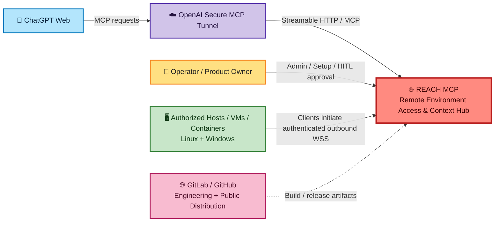
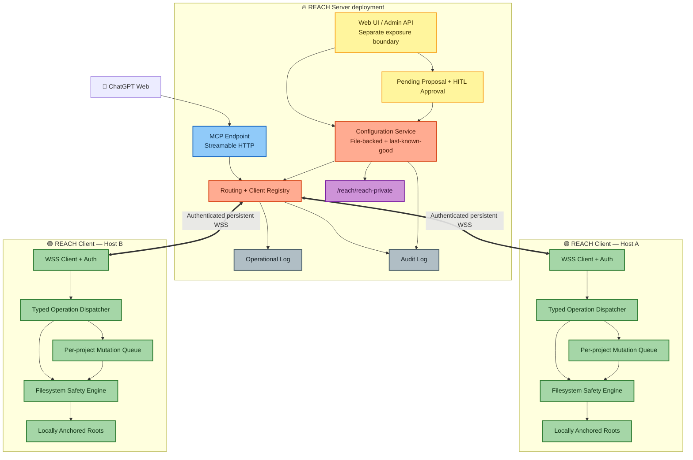
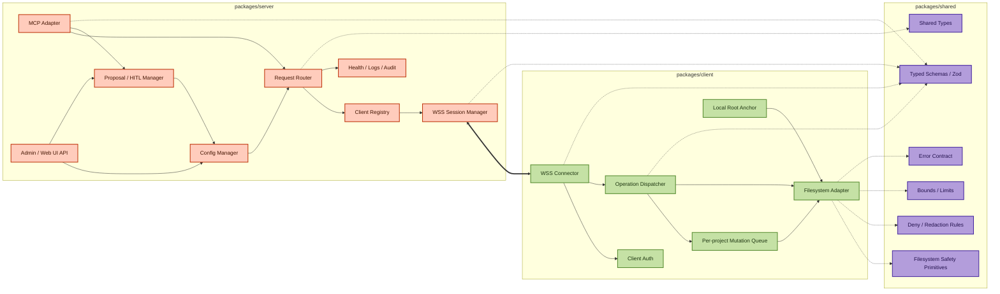
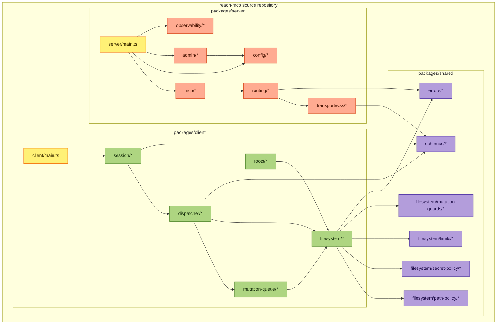
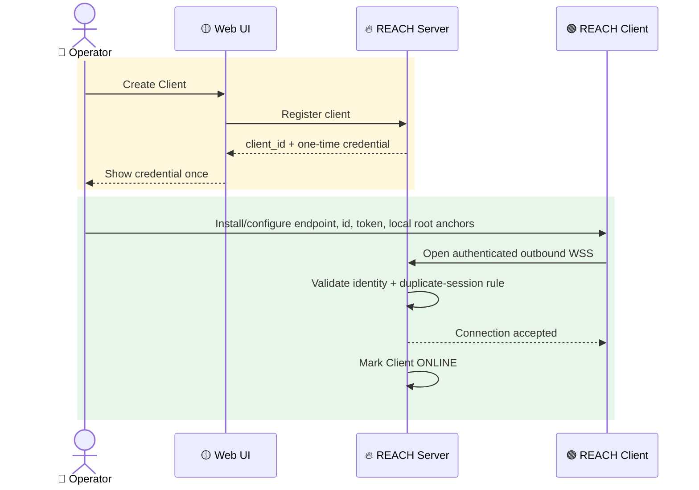
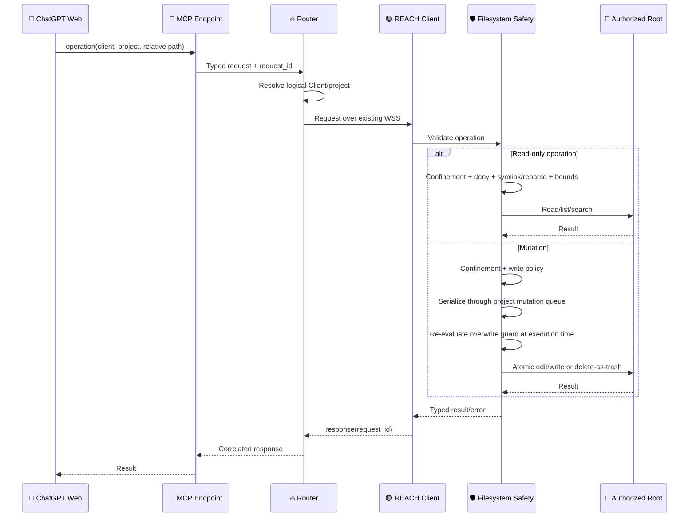
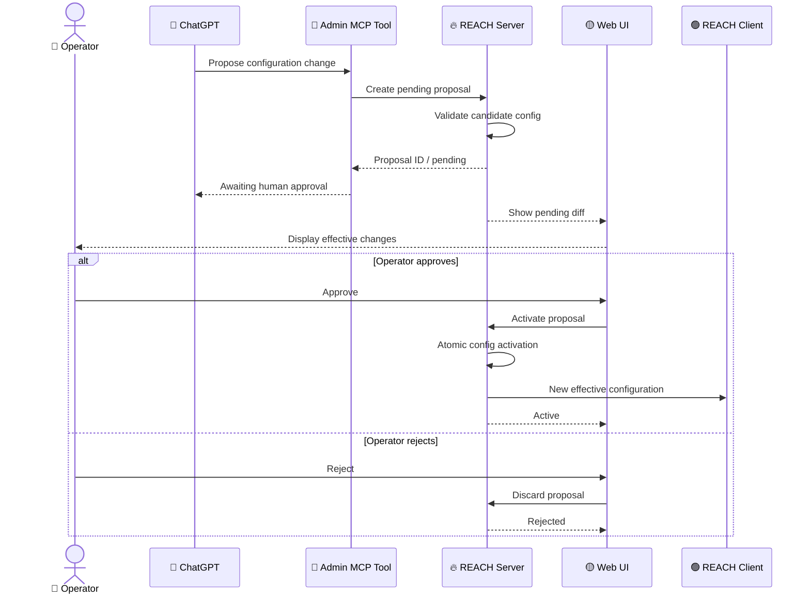
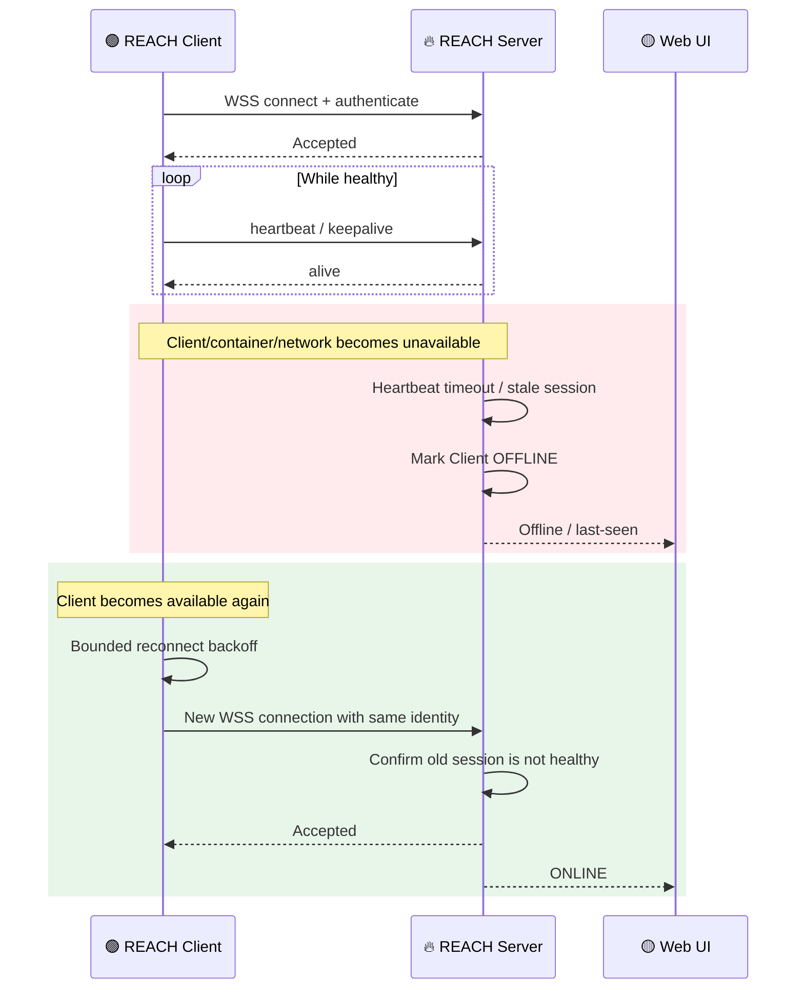
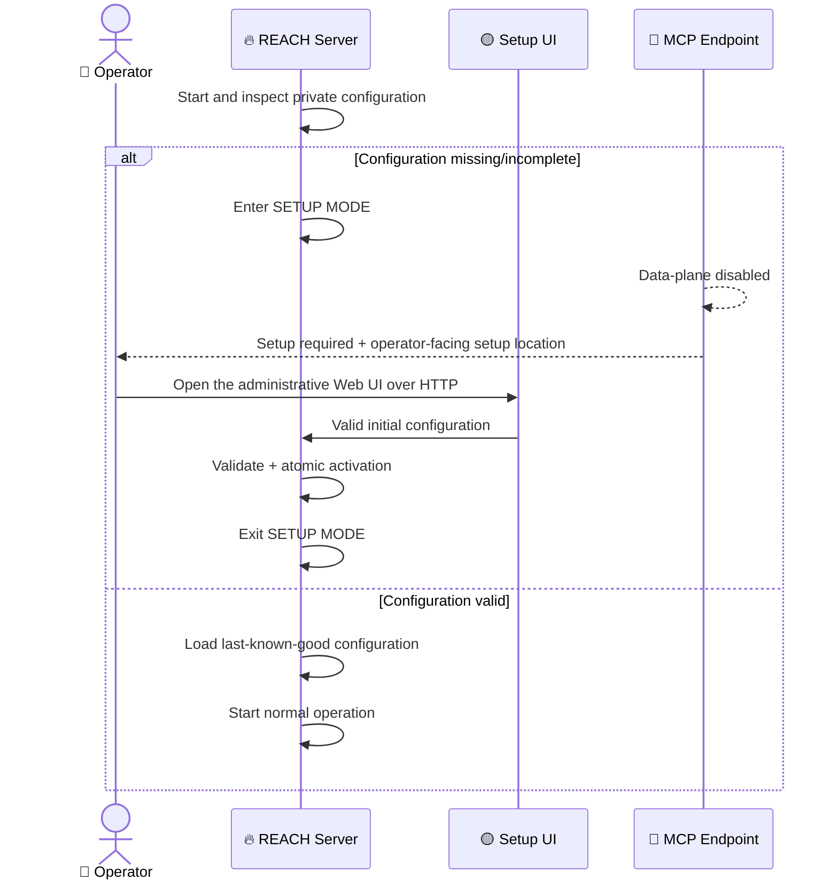

# REACH MCP — Architecture

**Status:** approved architecture. REACH is in pre-alpha development; implementation proceeds from this document.
**Product:** REACH MCP — Remote Environment Access & Context Hub.
**Purpose:** the canonical architecture authority, for design, implementation, review and future AI context. The other documents link here instead of restating it: [development-environment.md](development-environment.md) (develop and rebuild the environment), [configuration.md](configuration.md) (configure and operate), [install.md](install.md) (install, distribution and current state).

---

## 1. Product purpose and boundary

REACH gives **ChatGPT Web** controlled access to explicitly authorized files and project environments through one MCP endpoint.

### REACH owns

- ChatGPT Web-facing MCP access;
- REACH Server and REACH Clients;
- authenticated client registration and routing;
- logical project/root routing;
- project capability discovery;
- controlled filesystem list/find/read/search;
- bounded image reads;
- policy-restricted write/edit/delete-as-trash;
- filesystem confinement and safety invariants;
- Web UI configuration and operational visibility;
- health/status;
- operational logs and audit;
- Client installation/update flow.

### REACH does not own

- arbitrary shell execution;
- generic SSH command execution;
- Git workflow governance;
- Taiga workflow;
- generic remote administration;
- container orchestration;
- unrelated deployment orchestration;
- database control planes;
- a general-purpose secrets-management platform.

### Engineering principle

REACH is autonomous. Build, runtime, CI, tagging and release must not functionally depend on GitGate, Atlas, SCOPE or another unrelated project.

KISS and YAGNI are binding: protect against realistic failures; do not build speculative defensive machinery.

### Design principles

- **Outbound only.** Clients dial the Server; target machines expose no inbound REACH port.
- **Explicit roots.** Nothing is reachable unless a project root is configured; there is no default root.
- **Read-only by default.** Read operations are annotated as read-only for ChatGPT.
- **Bounded behavior.** Reads, search and listing operate under configurable limits.

---

## 2. Proven foundation to reuse

The current Dev MCP is a working prototype and provides proven implementation patterns that should be selectively ported rather than casually rewritten.

### Proven stack

- Node.js >= 24;
- TypeScript;
- ESM;
- `@modelcontextprotocol/server` and its Node adapter `@modelcontextprotocol/node` (MCP SDK v2);
- Zod;
- ChatGPT-facing MCP using Streamable HTTP.

Implemented runtime composition (Server): one Node HTTP listener exposes `/mcp` (stateless Streamable HTTP, dedicated bearer, a fresh MCP server and transport per request) and one WebSocket upgrade path for Clients, which is handed to the connection registry. Every other path answers 404; there is no admin UI, health route or MCP session state on this listener. The MCP tools are one discovery tool plus one tool per shared operation, each addressed by `client_id` and `project_id`.

REACH should remain Node/TypeScript unless a concrete blocker appears.

### Proven capabilities/primitives to port

- lexical path normalization;
- path confinement;
- secret-bearing path deny rules;
- additive deny patterns;
- likely-secret content redaction where appropriate;
- bounded file reads;
- bounded search;
- bounded directory listing;
- image type/size/dimension checks;
- restricted writes;
- atomic writes;
- delete-as-trash;
- trash retention/purge behavior;
- no arbitrary shell;
- focused security, confinement, portability and write tests;
- MCP tool annotations/hints where useful.

Temporary Git inspection may be retained only as isolated compatibility during migration if still required. It must remain architecturally disposable and must not become a permanent REACH responsibility.

---

## 3. Core topology

```text
ChatGPT Web
    |
    | MCP through OpenAI Secure MCP Tunnel
    v
REACH Server
    |
    +-- MCP API
    +-- Web UI
    +-- central configuration authority
    +-- routing / health / audit / logs
    |
    +====== authenticated persistent WSS ======+
    |                                         |
    v                                         v
REACH Client                              REACH Client
Host / VM / Container A                  Host / VM / Container B
    |                                         |
    +-- authorized roots                       +-- authorized roots
```

Target machines do not expose an inbound REACH port.

Each Client initiates one authenticated outbound WSS connection to the Server.

Clients may be on different hosts, networks, clouds or countries. They only need outbound reachability to the Server.

Shared storage, NFS, SMB or centralized filesystems may be used by an operator but are **not** REACH architecture requirements.

---


## 3A. Architecture diagrams — C4 model

The diagrams below are normative visual views of the approved architecture. Text in this baseline remains the source of truth if a rendering tool does not support a Mermaid feature.

### C1 — System Context



### C2 — Container / deployable view



### C3 — Component view



### C4 — Code / module responsibility view



---

## 3B. Critical sequence diagrams

### Sequence — Client enrollment and first connection



### Sequence — Normal filesystem read/write request



### Sequence — AI configuration proposal + HITL



### Sequence — Heartbeat, failure and reconnect



### Sequence — First boot / setup mode




## 4. Server authority and Client role

### REACH Server

The Server is the central control plane and source of truth for operational configuration.

It owns:

- ChatGPT-facing MCP endpoint;
- Web UI;
- client registration;
- client/project mapping;
- project roots;
- read/write capability configuration;
- routing;
- safe limits;
- observability;
- audit;
- persistence of private configuration.

### REACH Client

The Client is intentionally thin.

It:

- establishes/re-establishes the outbound WSS connection;
- authenticates with a unique client identity and credential;
- receives typed filesystem operations;
- executes them locally;
- enforces non-negotiable code-level safety invariants.

The Client is an execution/enforcement point, not an independent configuration authority.

### Local root anchor

The Server remains the operational configuration authority, but each Client has one minimal local safety boundary established during enrollment: the set of physical base roots that this Client is ever allowed to expose.

The Server may define logical projects, modes, allowlists, deny rules and limits only inside those locally authorized roots. The Client refuses any Server configuration or request that resolves outside that local root set.

This is not a second policy system. It is a host-level blast-radius boundary stored in the same local env-style configuration used for Server endpoint, client identity and credential.

When Server configuration changes, the effective project/root policy is sent to the Client. The Client validates the received policy against its local root anchors before accepting it; any policy that escapes those anchors is rejected.

---

## 5. Logical routing model

A single Client may expose multiple explicitly configured roots.

Example:

```text
client: scope-dev
  project: scope       -> /scope
  project: etc         -> /etc
  project: gitlab-mcp  -> /some/physical/path
```

Normal MCP operations use logical identities only:

- `client`;
- logical `project`/root name;
- path relative to that root.

Example target:

```text
client=scope-dev
project=scope
path=docs/example.md
```

ChatGPT does not need to know the Client IP, host name, transport port or physical filesystem root during normal operation.

The Server resolves logical identities to physical configuration and routes the request.

Cross-client and cross-project routing must be explicit and unambiguous.

---

## 6. Filesystem safety model

Requests operate inside an explicitly configured project root.

### Non-negotiable invariants

- reject lexical traversal such as `../`;
- reject absolute-path escape from the requested root;
- never permit deletion of the configured project root itself;
- no arbitrary shell;
- typed operations only;
- bounded reads/writes/search/results;
- delete uses trash behavior rather than immediate unlink where applicable.

### Symlinks

REACH does **not follow symlinks** for filesystem operations.

If an operation encounters a symlink:

- refuse the operation;
- return an explicit error saying the target is a symlink and access through it is not permitted;
- tell the caller/operator that the real target must be exposed deliberately as another configured project root if access is desired.

This applies to read, search, write, edit and delete.

Explicit mount/bind points inside an authorized root are allowed because they are intentional filesystem topology rather than path redirection by symlink.

### Default project posture

New project/root configuration defaults to **read-only**.

If controlled-write is explicitly enabled, the initial writable surface is restricted to `temp/**` with delete-as-trash unless the operator deliberately expands it.

Secret-bearing files such as `.env`, keys and credentials are denied by default.

CI/CD definition files such as `.gitlab-ci.yml`, workflow files and equivalent execution-control files are **not writable by default**. An operator may explicitly allow them, but that is a deliberate trust decision because changing CI/CD definitions can become shell-equivalent execution through the runner.

All ordinary policy values are centrally configurable through Server/Web UI. Non-negotiable safety invariants remain code-level constraints.

### Symlink discovery behavior

Direct operations on a symlink target remain refused. Directory listing and search do not fail merely because a directory contains symlinks; they skip symlink entries and continue safely without traversal.

### Protected overwrite guard

A full-file overwrite is refused when the existing target contains content that the read policy would deny or redact. This prevents a redacted read from later being written back over the original and destroying protected content.

Targeted `edit_file`-style mutation remains the preferred mechanism when safe matching is possible.

---

## 7. Client identity, enrollment and credentials

Each Client has:

- a unique `client_id`;
- a unique strong random credential generated by Server/Web UI.

### MVP enrollment

1. operator creates/registers the Client in Web UI;
2. Server generates `client_id` + credential;
3. credential is displayed exactly once during enrollment/rotation and is not recoverable afterward;
4. operator/installer/Claude places Server endpoint, `client_id` and credential on the target Client;
5. Client stores them in a private local env-style `KEY=VALUE` configuration file with restrictive filesystem permissions where supported;
6. the same local file records the physical base root(s) that this Client is allowed to expose;
7. Client establishes authenticated outbound WSS.

Manual/explicit first enrollment is intentional. No automatic remote enrollment is required for MVP.

### Credential rotation

KISS flow:

1. generate new credential;
2. update Client;
3. verify reconnection;
4. revoke old credential.

No dual-credential grace window is required for MVP.

---

## 8. Server-Client connection lifecycle

Exactly one active connection is allowed per `client_id`.

- second simultaneous connection for the same `client_id` is rejected explicitly;
- heartbeat/keepalive determines healthy vs stale;
- stale/closed connection marks Client offline;
- while running, Client retries with bounded backoff;
- if Client/container is stopped, Server simply shows it offline;
- when Client starts again, it reconnects with the same identity/credential;
- exact heartbeat/retry intervals are configuration/implementation details, not architecture constants.

The Server is authority for admission, routing, heartbeat state and lifecycle policy.

The Client initiates transport because the Server may not be able to open an inbound connection through NAT/firewall.

### Concurrent ChatGPT conversations

The Server does not need to know which ChatGPT conversation originated a request.

Multiple conversations may issue concurrent requests through the same MCP endpoint and same Client WSS connection.

Every operation has a unique request/correlation identifier. Responses must correlate to the correct request and never mix.

Reads may execute concurrently. Mutations are serialized per logical project/root through a simple queue so two concurrent conversations cannot silently overwrite each other's changes. Any overwrite/read-safety guard that depends on current file contents is re-evaluated when the queued mutation actually executes, not only when it is first accepted.

Timed-out mutation operations are **not automatically replayed** because execution state may be unknown. No ETag, transaction or generalized idempotency framework is required for MVP.

---

## 9. Runtime layout

Canonical umbrella root:

```text
/reach/
  reach-mcp/
  reach-private/
  reach-mcp-client/   # only on machines where the Client is installed
```

### Server

`/reach/reach-mcp` contains the built product/runtime.

Production containers do not require Git metadata or a working Git checkout.

Logs live under:

```text
/reach/reach-mcp/logs
```

### Private configuration

`/reach/reach-private` contains private configuration, real credentials, keys/certificates and environment-specific recovery/provisioning material.

This private area is never a public GitHub publication candidate.

### Client

`/reach/reach-mcp-client` is the separate **installed Client artifact/runtime location**. Its source code lives in the same `reach-mcp` repository under `packages/client`, sharing security-critical code through `packages/shared`.

A machine may run Server, Client or both.

### Persistence

Persistence is recommended but optional.

Operators may mount persistent volumes over:

- `/reach/reach-private`;
- `/reach/reach-mcp/logs`.

If not mounted, REACH creates/uses local directories inside the container/filesystem. Recreating that environment may lose configuration/logs; that is an explicit operator choice.

No generic extra `/reach/runtime` or `state` directory exists unless a real future requirement justifies it.

---

## 10. First boot and setup mode

If required private configuration is missing/incomplete:

- REACH enters **setup mode**;
- normal filesystem/data-plane capabilities remain disabled;
- MCP endpoint remains reachable enough to report that setup is required and provide the setup location/instructions;
- project operations remain unavailable until setup completes.

The administrative Web UI/API is served over HTTP as a separate exposure boundary from the ChatGPT MCP tunnel and is not published through the ChatGPT tunnel path by default.

Web UI is the canonical production configuration path.

No manually created production `.env` is required for Server setup.

The Web UI may persist structured configuration in a simple file-backed format (for example YAML or JSON). Exact representation is implementation detail as long as it is simple, inspectable and safely written.

---

## 11. Web UI behavior

The Web UI is operational, configuration-oriented and intentionally small.

### Dashboard should expose

- Server health;
- build/repository version;
- uptime;
- connected/disconnected Clients;
- last-seen/heartbeat;
- Client version;
- exposed logical roots/projects;
- effective access mode;
- recent errors;
- config validity;
- useful request/failure/timeout counters where they materially help operations.

### Configuration editing

Normal configuration uses **autosave**.

Changing an ordinary field, select/combo, toggle or checkbox persists automatically after a short debounce/validation interval.

There is **no generic Save button**.

Normal human-originated Web UI configuration remains autosave, including capability and allowlist changes.

Explicit action buttons are reserved only for actions that are inherently actions rather than field edits, such as:

- approve/reject an AI-generated configuration proposal;
- rotate/revoke a credential;
- destructive operations that are not ordinary configuration edits.

There is no generic Save/Confirm button for ordinary configuration changes.

---

## 12. AI-assisted configuration and HITL

REACH may expose typed administrative MCP operations so ChatGPT can inspect and propose configuration.

All AI/MCP-originated configuration mutations are proposal-based, regardless of whether a field is classified as security-sensitive:

1. ChatGPT creates/edits a pending configuration proposal;
2. proposal remains inactive;
3. Web UI shows the effective diff;
4. human operator explicitly approves/rejects;
5. only after approval does Server atomically activate the change.

Human-originated ordinary Web UI edits continue to use autosave.

This is explicit **human-in-the-loop (HITL)** governance.

Read-only inspection of current configuration may be exposed directly.

Autosave must never bypass the HITL approval gate.

---

## 13. Configuration integrity

- approved configuration changes activate atomically;
- invalid configuration must never replace the last-known-good active configuration;
- configuration must remain file-backed for MVP;
- no database-backed control plane is required.

---

## 14. Logging and diagnostics

Logs exist to diagnose and reconstruct what happened. They are not decorative.

### Operational log

Primary persisted log is human-readable plain text.

Useful fields include:

- timestamp;
- severity;
- component/module/function;
- request/correlation identifier when applicable;
- concise message.

Standard levels:

- DEBUG;
- INFO;
- WARNING;
- ERROR;
- CRITICAL;
- optional RUNNING-style operational level if it materially improves live visibility.

Console may use colors. Persisted files must not contain ANSI color escapes.

Heartbeat/connection lifecycle should be visible without becoming noisy.

A human, GPT or Claude with authorized access should be able to diagnose failures from logs rather than guess.

Never log secrets/credentials/file contents by default.

### Rotation

Operational logs rotate:

- at midnight;
- earlier if configurable maximum file size is reached.

Default retention: **5 days**.

Retention/size settings are configurable in Web UI.

---

## 15. Audit trail

Audit is separate from operational logging.

Purpose: answer **who did what, where, when and with what result** without creating banking-grade compliance infrastructure.

Default audit scope is broad/enabled. Web UI may allow categories to be disabled later.

Compact records should include the minimum useful context:

- timestamp;
- actor/source;
- client;
- project/root;
- operation/action;
- target/path when applicable;
- request/correlation identifier;
- result.

Do not record file contents, credentials or secrets.

Audit uses the same rotation model:

- midnight rotation;
- earlier rotation by size;
- default 5-day retention;
- Web UI configurable.

Audit must not become a duplicate of full application logs.

---

## 16. Process lifecycle and upgrades

Server and Client are independent services/processes.

They may run in containers, VMs or physical hosts.

### Runtime

- services may start automatically with their local supervisor;
- failed processes may be restarted by that supervisor;
- no hidden/autonomous REACH software upgrade.

### Upgrade

Upgrade is explicit:

1. deploy/download new artifact;
2. restart;
3. verify health.

The product must not silently mutate itself to a new version.

---

## 17. Client packaging and platform support

REACH uses **one source repository** with separate packages/artifacts:

```text
reach-mcp/
  packages/
    server/
    client/
    shared/
```

The Server and Client are distributed as independent artifacts, but security-critical filesystem primitives and shared wire schemas live once in `packages/shared` to avoid drift.

This is the target layout. The repository still holds the bootstrap tree (`src/`) until the implementation tasks introduce the packages.

Client must support:

- Linux;
- Windows.

For MVP, no native `.exe`/ELF compilation is required.

Preferred distribution:

- Node/TypeScript build/package;
- platform-appropriate bootstrap/install scripts.

Direct `git clone` is valid for development but is not the required public installation contract.

Linux may use systemd where appropriate. Windows must use a native Windows service/scheduled-start mechanism; systemd is never a Windows requirement.

The installer/bootstrap should remain simple, repeatable and should not become a package manager.

### Windows filesystem safety

Windows support must include platform-specific confinement tests and guards:

- case-insensitive normalization for confinement/deny checks;
- normalize drive-letter, UNC and backslash forms;
- treat junctions/reparse points as symlink-equivalent and refuse traversal;
- reject NTFS alternate data stream syntax;
- reject reserved device names;
- validate trash/rename semantics on Windows.

Windows CI must exercise traversal case variants, ADS, junction/reparse-point handling and UNC/path normalization.

---

## 18. Versioning and compatibility

The single REACH source repository retains the existing repository/tag versioning scheme generated by the project's CI process. Server and Client artifacts report that actual build/tag version.

Do **not** introduce:

- SemVer as a second versioning system;
- an independent protocol-version number for MVP.

At connection time, Server and Client report their actual running build/repository version for observability and troubleshooting.

The Server performs a simple compatibility gate using the build versions it knows are compatible. An incompatible Client is rejected with an explicit upgrade/downgrade error.

No independent protocol number, negotiation framework or second version taxonomy is introduced.

Installation tooling may resolve the latest available release only when the operator explicitly requests install/update to latest.

---

## 19. Server packaging / public deployment

The Server is intended to have a portable containerized deployment path.

Production/public deployment should use a built image/artifact rather than requiring a Git working tree inside the running container.

Docker/Compose may be used for public/production deployment.

Development may use Incus/systemd where that is the real environment, but those are not public product requirements.

---

## 20. CI/CD principles

CI starts early and remains self-contained.

Initial quality gate should cover:

- public-release/public-surface check;
- lint;
- typecheck;
- focused automated tests;
- build/package.

REACH CI/runtime/release must not require GitGate, Atlas, SCOPE or another external project.

Tag/release jobs are self-contained in the REACH repository and may use direct `git tag` + push through the GitLab CI job token or equivalent repository-native mechanism. SCOPE/GitGate governance may guide development process, but it is not a runtime/build/tagging dependency.

Do not introduce cosmetic lint bureaucracy.

CD should mature alongside deployable product slices rather than being postponed until the application is "finished".

Deployment target details must come from configuration/environment, not source hardcoding.

Rollback should restore a known-good artifact/configuration where deployment automation exists.

---

## 21. Migration from Dev MCP

The working Dev MCP remains available while REACH is built and proven.

Migration principles:

1. do not break the current working ChatGPT access path;
2. selectively port proven primitives/tests rather than importing old history blindly;
3. deploy REACH alongside Dev MCP;
4. connect ChatGPT Web to REACH while Dev MCP remains available;
5. dogfood REACH against a safe REACH root;
6. prove read/search/write/security/restart/reconnect;
7. install Client on SCOPE and expose `scope -> /scope`;
8. perform controlled comparison where useful;
9. move normal access to REACH only after evidence;
10. retire Dev MCP only after explicit Product Owner decision.

Public GitHub publication and Dev MCP retirement are independent decisions.

---

## 22. Public GitHub publication vs usable release

Public publication may happen **before** REACH is generally usable.

The repository should truthfully state:

- pre-alpha / active development;
- not production-ready;
- installation may not yet be available;
- an earlier working prototype exists and is being used as the development foundation for the redesigned distributed Server + Client architecture.

Early publication exists to expose real engineering work, architecture, roadmap, CI evolution, security model, HITL governance and implementation progress.

Do not hide limitations and do not overstate maturity.

### Minimum gate for changing status to generally usable

1. **Security baseline**
   - authenticated WSS;
   - unique Client credentials;
   - root confinement;
   - symlink refusal;
   - default secret protection;
   - no arbitrary shell.

2. **Reliability baseline**
   - reconnect behavior;
   - last-known-good configuration preservation;
   - no automatic replay of timed-out mutations.

3. **Portability baseline**
   - Client works on Windows and Linux;
   - Server has containerized deployment;
   - no functional dependency on SCOPE/GitGate/Atlas.

4. **Operability baseline**
   - functional Web UI;
   - setup mode;
   - useful logs/audit;
   - health visibility;
   - autosave.

5. **Release-quality baseline**
   - green CI;
   - focused tests;
   - clean install from scratch validated;
   - explicit/manual upgrade path validated.

Until these are met, public status remains development/pre-alpha.

---

## 23. Public documentation/security disclosure

Public documentation should clearly state that content explicitly requested through REACH may be transmitted to ChatGPT/OpenAI as part of fulfilling the user's request.

A concise `SECURITY.md` should describe:

- trust boundaries;
- what REACH protects;
- what REACH does not guarantee;
- how to report a security issue.

Do not build an elaborate threat-model bureaucracy for MVP.

Public repository/history must contain no real secrets, credentials, private keys or private-only configuration.

---

## 24. Private repository boundary

`reach-private` is private, GitLab-only recovery/configuration material for the Product Owner environment.

It may contain:

- real REACH environment/configuration;
- keys/certificates;
- private topology/mappings;
- provisioning/bootstrap material;
- private deployment configuration;
- backup/restore procedures.

This is an explicit Product Owner risk decision.

Do not force Vault/KMS/SOPS or another secret subsystem unless later requested.

Rules:

- never mirror `reach-private` to public GitHub;
- public `reach-mcp` must not contain real secrets;
- normal GPT/Claude workflows should not print secret values;
- logs/CI must not echo secrets.

---

## 25. Engineering operating model

Use established software-engineering practices pragmatically:

- separation of concerns;
- high cohesion / low coupling;
- explicit module boundaries;
- small interfaces;
- single responsibility at module level;
- behavior/boundary tests;
- KISS;
- YAGNI;
- no speculative abstractions.

Clean Code, SOLID, Ports-and-Adapters and Strangler-style migration are tools, not religions.

Do not add factories, repositories, event buses, plugin frameworks or generic adapters merely because such patterns exist.

A pattern is useful only when it reduces coupling, improves replaceability or improves testability.

---

## 26. Self-deployment / control-plane safety

Because REACH may eventually access its own source/configuration, implementation must avoid creating a trivial self-destruction loop.

At minimum:

- deployed runtime must not require writable access to its own active executable/build files for ordinary operation;
- configuration changes follow validation + atomic activation;
- deleting the active configured root itself is impossible;
- destructive self-management is never an accidental side effect of ordinary file tools.

Do not build a generalized self-management framework unless a real need appears.

---

## 27. Current architecture verdict

**READY TO IMPLEMENT.**

No material architecture question remains open.

The next work is execution:

1. retain the CI independence already established;
2. port proven safe filesystem primitives;
3. implement Client identity/enrollment and persistent WSS;
4. implement Server routing and configuration;
5. implement setup mode/Web UI/HITL;
6. implement logging/audit;
7. dogfood;
8. migrate SCOPE while Dev MCP remains available;
9. publish progress publicly as pre-alpha when approved.

Any future architecture change must identify a concrete requirement or defect; do not reopen settled decisions for cosmetic redesign.
