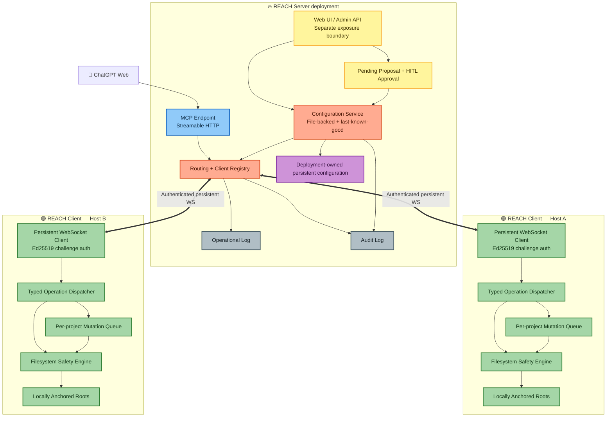
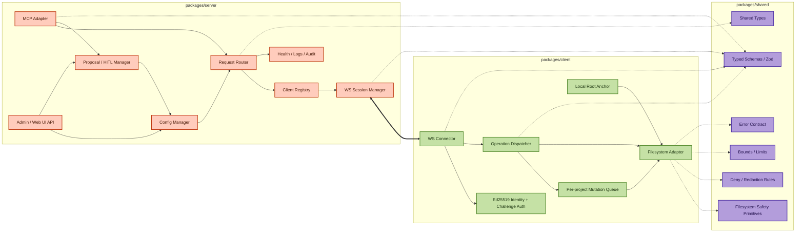
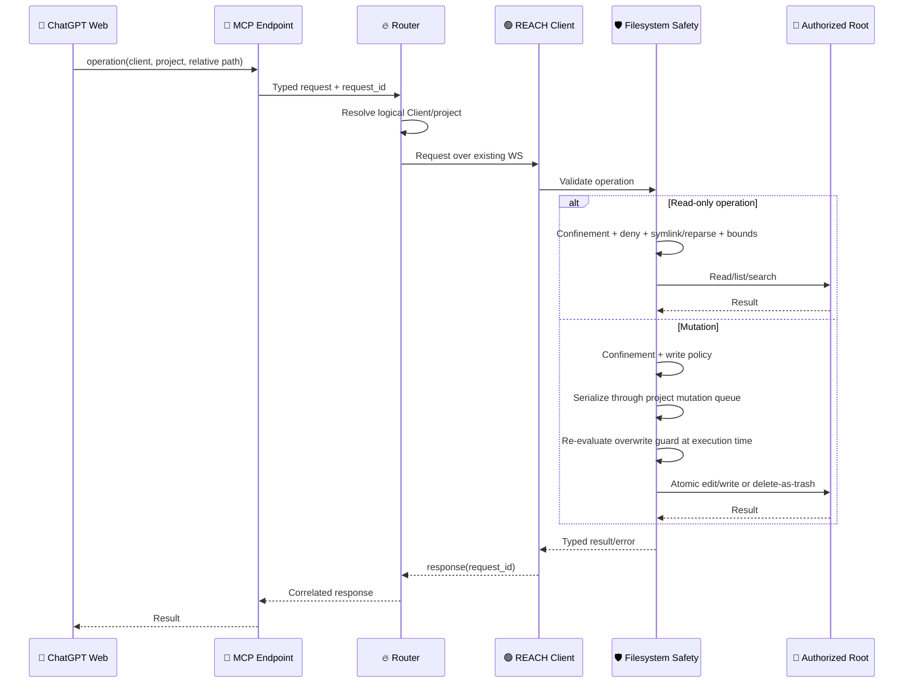
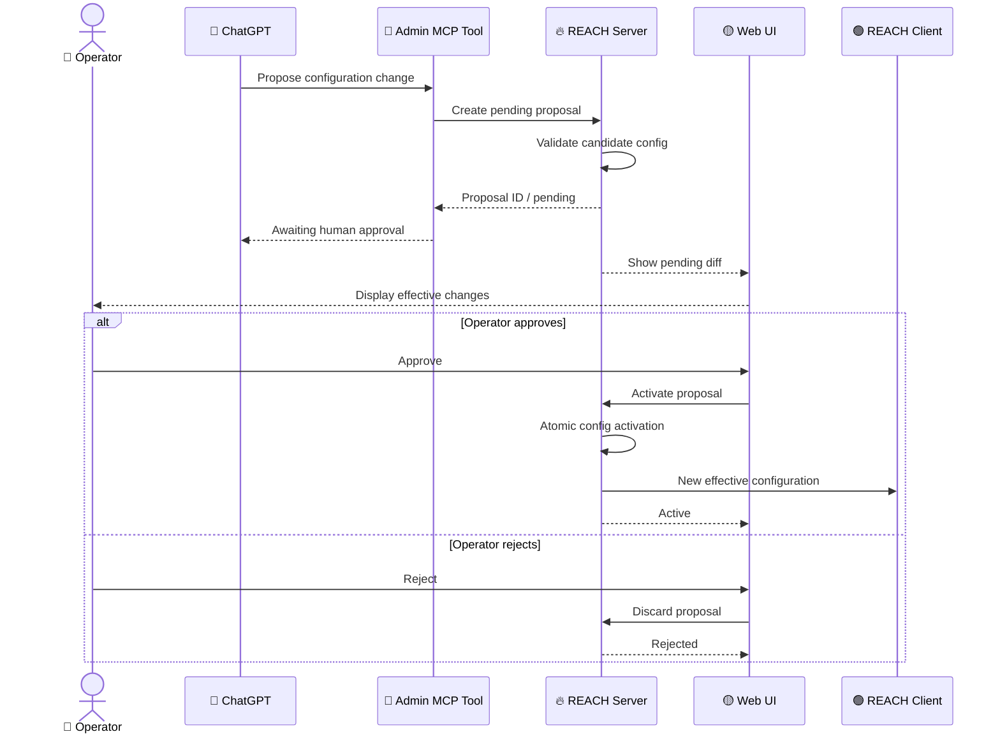
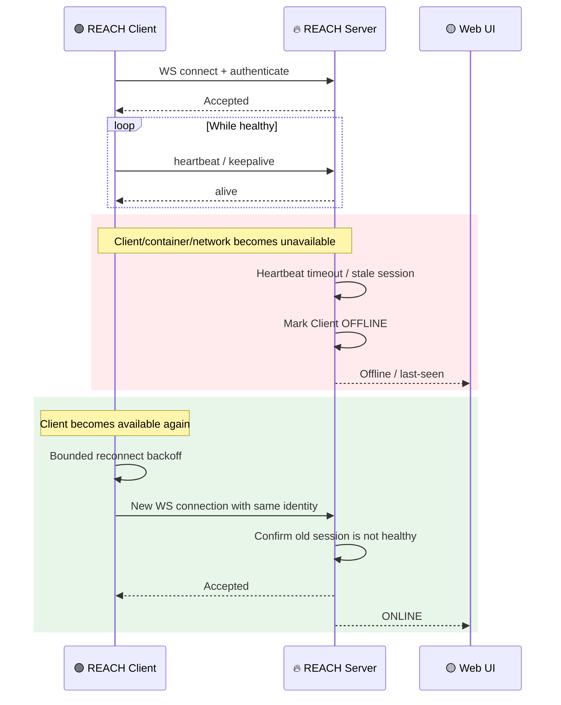

# REACH MCP — Architecture

**Status:** approved architecture with a working production implementation. REACH remains pre-alpha while SCOPE migration and the remaining production hardening backlog are completed; this document describes the architecture that exists now, not a future target.
**Product:** REACH MCP — Remote Environment Access & Context Hub.
**Purpose:** the canonical architecture authority, for design, implementation, review and future AI context. The other documents link here instead of restating it: [development-environment.md](development-environment.md) (develop and rebuild the environment), [configuration.md](configuration.md) (configure and operate), [install.md](install.md) (install, distribution and current state).

---

## 1. Product purpose and boundary

REACH gives **ChatGPT Web** controlled access to explicitly authorized files and project environments through one MCP endpoint.

### REACH owns

- ChatGPT Web-facing MCP access;
- REACH Server and REACH Clients;
- authenticated client registration and routing;
- logical project/root routing;
- project capability discovery;
- controlled filesystem list/find/read/search;
- bounded image reads;
- policy-restricted write/edit/delete-as-trash;
- filesystem confinement and safety invariants;
- Web UI configuration and operational visibility;
- health/status;
- operational logs and audit;
- Client installation/update flow.

### REACH does not own

- arbitrary shell execution;
- generic SSH command execution;
- Git workflow governance;
- Taiga workflow;
- generic remote administration;
- container orchestration;
- unrelated deployment orchestration;
- database control planes;
- a general-purpose secrets-management platform.

### Engineering principle

REACH is autonomous. Build, runtime, CI, tagging and release must not functionally depend on GitGate, Atlas, SCOPE or another unrelated project.

KISS and YAGNI are binding: protect against realistic failures; do not build speculative defensive machinery.

### Design principles

- **Outbound only.** Clients dial the Server; target machines expose no inbound REACH port.
- **Zero-touch onboarding.** Normal installation starts from one operator instruction to an authorized agent: access the target machine and install the Client. Artifact retrieval, identity creation, enrollment, bootstrap creation, service installation and first connection are automatic.
- **One owner per responsibility.** Client identity key generation belongs to the Client; public-key admission and routing belong to the Server; private environment defaults belong to deployment/private configuration; filesystem safety belongs to the Client safety engine. No duplicated owner or parallel credential system.
- **Explicit roots after onboarding.** The onboarding path may propose the agent's current project directory as the initial project root, but the Client must know the exact local anchor it is authorizing and the Server must persist the resulting logical project mapping. The operator may explicitly authorize any valid absolute root, including a filesystem root such as `/` or a Windows drive root such as `C:\\`. REACH must not invent path-depth or topology restrictions as safety proxies. When the selected anchor exposes an entire filesystem/drive, the product must warn clearly that the whole filesystem/drive is being shared and require explicit operator confirmation before activation. There is no source-code hardcoded project root.
- **Read-only by default outside the controlled writable surface.** Initial controlled write access is limited to `temp/**` with delete-as-trash unless later changed through Server configuration/UI.
- **Bounded behavior.** Reads, search and listing operate under configurable limits.

---

## 2. Proven foundation to reuse

The current Dev MCP is a working prototype and provides proven implementation patterns that should be selectively ported rather than casually rewritten.

### Proven stack

- Node.js >= 24;
- TypeScript;
- ESM;
- `@modelcontextprotocol/server` and its Node adapter `@modelcontextprotocol/node` (MCP SDK v2);
- Zod;
- ChatGPT-facing MCP using Streamable HTTP.

Implemented runtime composition (Server): one Node HTTP listener exposes `/mcp` (stateless Streamable HTTP, dedicated bearer, a fresh MCP server and transport per request) and one WebSocket upgrade path for Clients, which is handed to the connection registry. `GET /health` is the single service-plane health contract and stays behind the same bearer: missing/wrong bearer returns 401; while no configuration is active it returns 503; with active configuration it returns the minimal operational snapshot (`status`, `server_build`, `repository_commit`, `uptime_seconds`, `config_active`, Client online/build/last-seen state and request totals). It never includes roots, private keys, bearer values, credentials or paths. There is no second readiness route. `GET /`, `GET /install.sh` and `GET /install.ps1` are the public install-discovery routes (`install-discovery.ts`): a minimal page with the canonical Client install commands for the request's own safe `Host` (never a forwarded header), and the two fixed installer scripts, whose bytes come only from the injected `ArtifactSource` by those two exact names; a command is advertised only while its installer exists, any other method is 405 and the page never depends on Admin or on an active configuration. Every other non-release, non-install path answers 404; there is no admin UI or MCP session state on this listener. Each MCP tool result carries the `request_id` that travelled on the wire to the Client. The MCP tools are one discovery tool plus one tool per shared operation, each addressed by `client_id` and `project_id`.

REACH is Node/TypeScript. **All first-party source, tooling and tests are TypeScript.** `.mjs` is not an accepted project source format. Existing `.mjs` files are implementation debt to migrate to `.ts`; do not add new `.mjs` files. An exception is allowed only when a concrete runtime or packaging constraint makes TypeScript impossible, with explicit Product Owner approval and documentation of that constraint.

### Proven capabilities/primitives to port

- lexical path normalization;
- path confinement;
- secret-bearing path deny rules;
- additive deny patterns;
- likely-secret content redaction where appropriate;
- bounded file reads;
- bounded search;
- bounded directory listing;
- image type/size/dimension checks;
- restricted writes;
- atomic writes;
- delete-as-trash;
- trash retention/purge behavior;
- no arbitrary shell;
- focused security, confinement, portability and write tests;
- MCP tool annotations/hints where useful.

Temporary Git inspection may be retained only as isolated compatibility during migration if still required. It must remain architecturally disposable and must not become a permanent REACH responsibility.

---

## 3. Core topology

```text
ChatGPT Web
    |
    | MCP through OpenAI Secure MCP Tunnel
    v
REACH Server
    |
    +-- MCP API
    +-- Web UI
    +-- central configuration authority
    +-- routing / health / audit / logs
    |
    +====== authenticated persistent WS ======+
    |                                         |
    v                                         v
REACH Client                              REACH Client
Host / VM / Container A                  Host / VM / Container B
    |                                         |
    +-- authorized roots                       +-- authorized roots
```

Target machines do not expose an inbound REACH port.

Each Client initiates one authenticated outbound WS connection to the Server.

Clients may be on different hosts, networks, clouds or countries. They only need outbound reachability to the Server.

### Server network endpoints

The Server exposes **two listeners** with separate responsibilities. **8787** is the service plane: `/mcp` for ChatGPT-facing MCP, `/client` for persistent Client WebSocket sessions, `/health`, read-only release routes under `/release/...`, and the minimal Client enrollment exchange needed for zero-touch installation. **8788** is the administrative plane: `/` and `/admin/...` only.

The OpenAI Secure MCP Tunnel routes only `/mcp` on 8787. Client machines reach the Server directly on the local/private network; Client↔Server traffic does not depend on the OpenAI tunnel.

Administrative reachability is not hardcoded in public source. Port 8788 has no application login in the MVP, so its protection is the network boundary: the Server defaults to loopback and the production deployment must state its exposure explicitly (`REACH_ADMIN_BIND` for host publication, `REACH_ADMIN_ALLOW_FROM` for the allowlist, no defaults, supplied as deployment configuration outside the repository). A non-loopback bind is supported only with an explicit source IP/CIDR allowlist and the network boundary around it. The allowlist is checked against the direct peer address, never `X-Forwarded-For`; proxying the admin plane is out of scope for now. The Web UI may later change Clients, projects, roots, modes and key rotation, but it is not required for first installation.

Admin UI structure (implemented, `packages/server/src/admin-ui/`). The page is one self-contained vanilla document with one owner per responsibility, so a change is made once and reaches every screen: `theme.ts` owns every color (dark is the polished theme; light only fills the same semantic slots), `design.ts` owns spacing, radii, type scale and shell geometry, `components.ts` owns the canonical primitives (Card, Pill, Row, Toggle, Input/Field/Select, Button, Table, Unavailable state, Autosave indicator; a view calls `UI.pill(text, tone)` and never styles a pill itself, so reshaping the pill token reshapes every pill), `nav.ts` owns the single menu list (Overview, Clients, Projects, System, API, Logs) that both the sidebar and the router are built from, `shell.ts` owns the full-viewport frame, the whole-viewport network background and the hash router, and each view has its own module. The Overview reads only `/admin/api/state` and `/admin/api/clients`: the Server classes each Client once as pending, enabled or disabled and joins the live-session facts (online/offline, last seen), so the counters and the donut always add up, and the OpenAI tunnel, private mount and recent administrative actions are shown as "not exposed yet" until the Server exposes them. Structural tests (`packages/server/tests/admin-ui.test.ts`) fail on a duplicated or reordered menu, a second implementation of a primitive, or a color outside `theme.ts`. The Clients screen (`clients.ts`) is a view over `/admin/api/clients` and the Enable, Disable and Rotate Key actions; it reuses the same shell, tokens and components, refreshes on the shell's one poller and holds no policy. The Projects screen (`projects.ts`) edits the Client/project/root/mode mappings through the one `/admin/api/config` owner with ~500 ms autosave (Access reuses the Clients enable/disable endpoint). The System screen reads `/admin/api/system` (Server identity, free space of the configured log and artifact directories, runtime and process facts; tunnel and update are shown as not exposed because they belong to the deployment). The API screen reads `/admin/api/endpoints`, the one endpoint catalog (`endpoint-catalog.ts`: only routes that exist, status from owner facts) plus the Server's request counters; latency and request rate are not measured and say so. The Logs screen reads `/admin/api/logs`, a bounded read-only view (`log-reader.ts`) over the existing operational and audit files: only canonical regular files in the configured log directory, no symlinks, capped files, bytes and events. The footer shows the Server's `server_build`, which the release pipeline sets to the Git tag version. The approved visual contract for the six screens is the image pack `docs/screens/01_overview.png` to `06_logs.png` (logo: `07_logo_reach.png`): structure, proportions and hierarchy follow it, while data the Server does not own is shown as not exposed or not measured instead of the sample numbers in the images; the footer version also refreshes on the shell's one poller.

Release download and first enrollment require only service-plane network reachability. No admin tunnel, manual credential relay or manual bootstrap editing is part of the normal onboarding path.

Shared storage, NFS, SMB or centralized filesystems may be used by an operator but are **not** REACH architecture requirements.

---


## 3A. Architecture diagrams — C4 model

The diagrams below are normative visual views of the approved architecture. Text in this baseline remains the source of truth if a rendering tool does not support a Mermaid feature.

### C1 — System Context


### C2 — Container / deployable view



### C3 — Component view



### C4 — Code / module responsibility view


---

## 3B. Critical sequence diagrams

### Sequence — zero-touch Client enrollment and first connection

```mermaid
sequenceDiagram
    actor O as 👤 Operator
    participant A as 🤖 Authorized install agent
    participant C as 🟢 REACH Client
    participant S as 🔥 REACH Server

    O->>A: Access machine X and install the Client
    A->>S: GET release manifest + platform artifact
    A->>A: Verify hash/size and install runtime
    A->>C: Start first-run enrollment
    C->>C: Generate client_id + Ed25519 keypair locally
    C->>C: Keep private key local only
    C->>S: Enrollment(public key + non-secret metadata)
    S->>S: Verify proof of private-key possession
    S->>S: Register Client as Pending with public key only
    S-->>C: Pending; no operational access
    O->>S: Enable Client through Admin UI/API
    S->>S: Mark Client Enabled
    C->>C: Persist private key + local bootstrap/anchors with restrictive permissions
    C->>S: Open persistent WebSocket
    S-->>C: Random challenge
    C-->>S: Ed25519 signature(challenge)
    S->>S: Verify signature with stored public key and Enabled state
    S-->>C: Connection accepted
    S->>S: Mark Client ONLINE
    A-->>O: Connected
```

The Server never receives or stores the Client private key. The public key is the Server-side identity material and may be mirrored in the owner's private recovery/configuration repository. Authentication happens when a WebSocket connection is opened; ordinary messages on that established connection are not re-signed individually. Reconnection performs a fresh challenge/response.

### Sequence — Normal filesystem read/write request



### Sequence — AI configuration proposal + HITL



### Sequence — Heartbeat, failure and reconnect



### Sequence — First boot / setup mode

```mermaid
sequenceDiagram
    actor O as 👤 Operator
    participant S as 🔥 REACH Server
    participant UI as 🟡 Setup UI
    participant M as 🔵 MCP Endpoint

    S->>S: Start and inspect private configuration

    alt Configuration missing/incomplete
        S->>S: Enter SETUP MODE
        M-->>M: /mcp and /client refuse normal operation
        M-->>O: /health remains protected and reports 503; canonical /release files remain read-only
        M-->>O: Setup required + operator-facing setup location
        O->>UI: Open the administrative Web UI over HTTP
        UI->>S: Valid initial configuration
        S->>S: Validate + atomic activation
        S->>S: Exit SETUP MODE
    else Configuration valid
        S->>S: Load last-known-good configuration
        S->>S: Start normal operation
    end
```


## 4. Server authority and Client role

### REACH Server

The Server is the central control plane and source of truth for operational configuration.

It owns:

- ChatGPT-facing MCP endpoint;
- Web UI;
- client registration;
- client/project mapping;
- project roots;
- read/write capability configuration;
- routing;
- safe limits;
- observability;
- audit;
- persistence of private configuration.

### REACH Client

The Client is intentionally thin.

It:

- generates and owns its unique Ed25519 private/public keypair;
- keeps the private key local and never transmits it;
- establishes/re-establishes the persistent outbound WebSocket connection;
- proves identity once per connection by signing a Server challenge with Ed25519;
- receives typed filesystem operations;
- executes them locally;
- enforces non-negotiable code-level safety invariants.

The Client is an execution/enforcement point and identity-key owner, not an independent operational policy authority.

### Local root anchor

The Server remains the operational configuration authority, but each Client has one minimal local safety boundary established during onboarding: the set of physical base roots that this Client is ever allowed to expose.

For the normal zero-touch install, the authorized agent proposes the directory in which it is operating as the initial project/root when that is unambiguous. If confirmation is needed, the only normal question is whether that proposed directory should be the initial root. Controlled write access initially remains limited to `temp/**`; everything else follows the configured mode and safety rules.

The Server may define logical projects, modes, allowlists, deny rules and limits only inside locally authorized roots. The Client refuses any Server configuration or request that resolves outside that local root set.

This is not a second policy system. It is a host-level blast-radius boundary stored in the Client's protected local state together with the Server endpoint, client identity and private key. Private environment defaults and recovery metadata belong to deployment/private configuration, not public source.

When Server configuration changes, the effective project/root policy is sent to the Client. The Client validates the received policy against its local root anchors before accepting it; any policy that escapes those anchors is rejected. The anchor itself is an operator decision and may intentionally be as broad as the filesystem/drive root after explicit confirmation. Confinement means “never escape the selected anchor”; it does not mean REACH may substitute its own opinion about how narrow that anchor must be.

---

## 5. Logical routing model

A single Client may expose multiple explicitly configured roots.

Example:

```text
client: scope-dev
  project: scope       -> /scope
  project: etc         -> /etc
  project: gitlab-mcp  -> /some/physical/path
```

Normal MCP operations use logical identities only:

- `client`;
- logical `project`/root name;
- path relative to that root.

Example target:

```text
client=scope-dev
project=scope
path=docs/example.md
```

ChatGPT does not need to know the Client IP, host name, transport port or physical filesystem root during normal operation.

The Server resolves logical identities to physical configuration and routes the request.

Cross-client and cross-project routing must be explicit and unambiguous.

---

## 6. Filesystem safety model

Requests operate inside an explicitly configured project root.

### Non-negotiable invariants

- reject lexical traversal such as `../`;
- reject absolute-path escape from the requested root;
- never permit deletion of the configured project root itself;
- no arbitrary shell;
- typed operations only;
- bounded reads/writes/search/results;
- delete uses trash behavior rather than immediate unlink where applicable.

### Symlinks

REACH does **not follow symlinks** for filesystem operations.

If an operation encounters a symlink:

- refuse the operation;
- return an explicit error saying the target is a symlink and access through it is not permitted;
- tell the caller/operator that the real target must be exposed deliberately as another configured project root if access is desired.

This applies to read, search, write, edit and delete.

Explicit mount/bind points inside an authorized root are allowed because they are intentional filesystem topology rather than path redirection by symlink.

### Default project posture

New project/root configuration defaults to **read-only**.

If controlled-write is explicitly enabled, the initial writable surface is restricted to `temp/**` with delete-as-trash unless the operator deliberately expands it.

Secret-bearing files such as `.env`, keys and credentials are denied by default.

CI/CD definition files such as `.gitlab-ci.yml`, workflow files and equivalent execution-control files are **not writable by default**. An operator may explicitly allow them, but that is a deliberate trust decision because changing CI/CD definitions can become shell-equivalent execution through the runner.

All ordinary policy values are centrally configurable through Server/Web UI. Non-negotiable safety invariants remain code-level constraints.

The project access model is one canonical policy object, not an ACL hierarchy and not one project per permission level. `physical_root` defines the readable base scope; `writable_globs` narrows the mutation surface when controlled write is enabled; `deny_globs` are additive restrictions that win over writable allowlists; limits travel with the same effective policy. Server persistence, wire policy sync, Client enforcement and Admin UI all consume that same contract. The Dev MCP's proven `PROJECT_ROOT` + restricted write paths + additive deny rules + trash-delete behavior is the behavioral reference, adapted to REACH's distributed Server-owned policy model rather than copied as a parallel implementation.

The approved Admin interaction is a right-side Project Access drawer over the Projects page, visually matching `docs/screens/REACH 08_MCP Project Access Dashboard.png`. It edits the full project access policy with explicit Save/Cancel; the row-level UI must not imply that adding another logical project is the way to express a narrower writable path.

### Symlink discovery behavior

Direct operations on a symlink target remain refused. Directory listing and search do not fail merely because a directory contains symlinks; they skip symlink entries and continue safely without traversal.

### Protected overwrite guard

A full-file overwrite is refused when the existing target contains content that the read policy would deny or redact. This prevents a redacted read from later being written back over the original and destroying protected content.

Targeted `edit_file`-style mutation remains the preferred mechanism when safe matching is possible.

---

## 7. Client identity, enrollment and keys

Each Client has:

- a unique `client_id`;
- one Ed25519 keypair generated locally by that Client;
- one private key that never leaves the Client machine;
- one public key stored by the Server as the Client authentication identity.

### Zero-touch enrollment

Normal enrollment is zero-touch up to registration when an authorized agent can access the target machine and the machine can reach the Server service plane:

1. the agent downloads the correct platform Client artifact from the Server and verifies the release manifest/hash;
2. the Client generates its `client_id` and Ed25519 keypair locally;
3. the Client keeps the private key in protected local state and sends only its public key plus non-secret enrollment metadata and proof of private-key possession to the Server;
4. the Server stores the Client identity/public key as **Pending**; Pending Clients have no operational access;
5. a human explicitly selects **Enable** in the Admin UI/API;
6. the Server marks the Client **Enabled** and returns effective logical project/policy defaults;
7. the Client stores the Server endpoint, local private key and physical root anchors in protected local state;
8. the Client opens a persistent outbound WebSocket;
9. the Server sends a fresh random challenge and the Client signs it with Ed25519;
10. the Server verifies the signature and Enabled state before accepting the connection.

The normal operator interaction is one instruction to install the Client plus the explicit human Enable gate. No credential copy/paste, admin-port tunnel or hand-written bootstrap is part of first enrollment. Disabled Clients are disconnected and refused until re-enabled.

There is no hardcoded/default project root. The installer may propose the install agent's current working directory, but that root exists only after an unambiguous choice or explicit confirmation is persisted as the Client's local root anchor and mapped logically by the Server. Any normal question is about that root choice only, never identity or credentials. Controlled write access starts at `temp/**` unless private deployment configuration says otherwise.

### Key rotation

KISS flow:

1. the operator requests rotation through the administrative UI;
2. the Server asks the connected Client to generate a fresh Ed25519 keypair locally;
3. the Client keeps the candidate private key in memory and sends only the new public key; its valid key is not touched;
4. the Server durably stages that public key NEXT to the valid one and only then tells the Client to commit (`rotate_committed`);
5. the Client writes the candidate as its identity and reconnects with it; either key authenticates until then;
6. the first reconnect that proves the new key promotes it, and only then is the old keypair no longer accepted.

Failure matrix: if the Server cannot persist the staged key, no commit is sent and the old key keeps working; if the commit is lost or the Client cannot write its file, the Client keeps the old key, which the Server still accepts; if the Client crashes after writing, the Server already holds the new key; if promotion cannot be persisted, the staged key still authenticates and the next proof retries. No single failure leaves the two sides without a common key.

There is no Server-generated Client secret to display, copy or recover.

---

## 8. Server-Client connection lifecycle

Exactly one active connection is allowed per `client_id`.

- Client opens one persistent outbound WebSocket to the Server;
- authentication occurs once per connection with a fresh Server challenge and Ed25519 signature;
- ordinary messages on an authenticated connection are not individually re-signed;
- second simultaneous connection for the same `client_id` is rejected explicitly;
- heartbeat/keepalive determines healthy vs stale;
- stale/closed connection marks Client offline;
- while running, Client retries with bounded backoff;
- if Client/container is stopped, Server simply shows it offline;
- when Client starts again, it reconnects with the same identity and performs a new challenge/response;
- exact heartbeat/retry intervals are configuration/implementation details, not architecture constants.

The Client owns its private identity key. The Server owns admission, the Client public-key registry, routing, heartbeat state and lifecycle policy.

The Client initiates transport because the Server may not be able to open an inbound connection through NAT/firewall.

### Concurrent ChatGPT conversations

The Server does not need to know which ChatGPT conversation originated a request.

Multiple conversations may issue concurrent requests through the same MCP endpoint and same Client WS connection.

Every operation has a unique request/correlation identifier. Responses must correlate to the correct request and never mix.

Reads may execute concurrently. Mutations are serialized per logical project/root through a simple queue so two concurrent conversations cannot silently overwrite each other's changes. Any overwrite/read-safety guard that depends on current file contents is re-evaluated when the queued mutation actually executes, not only when it is first accepted.

Timed-out mutation operations are **not automatically replayed** because execution state may be unknown. No ETag, transaction or generalized idempotency framework is required for MVP.

---

## 9. Runtime layout

The source repository, private operator material and installed Client runtime are separate concerns. The Product Owner's DEV environment currently uses the `/reach` umbrella for source/private material, but those paths are environment-specific rather than public product defaults.

### Server

Production runs from a built Server artifact/image and does not require Git metadata or a working source checkout. Server configuration, proposal state, operational logs and tunnel material are explicit deployment inputs/mounts derived from an operator-selected persistent root; no source repository path is part of the product contract.

### Private configuration

Private configuration, credentials, keys/certificates and environment-specific recovery/provisioning material are operator-owned and never part of a public artifact. In the Product Owner environment, live Server/Client private runtime files are grouped under `reach-private/runtime/server` and `reach-private/runtime/client`, while provisioning remains separate under `reach-private/provisioning`. That private layout is not a product default.

### Client

The Client is installed **once per machine**, never once per logical project. Canonical install defaults are:

- Linux: `/opt/reach-mcp-client`;
- Windows: `C:\\Program Files\\REACH\\Client`.

Both are explicitly overridable by the operator. The bootstrap file is separate from the install directory and is the only local owner of endpoint, Client identity, credential and physical root anchors. A machine may run Server, Client or both.

### Persistence

Persistence is explicit and deployment-owned. Production accepts an operator-selected persistent root as an installation input, then mounts only the concrete files/directories each service needs. The root may be empty on first boot (setup mode) or pre-seeded from operator backup/recovery material. The Client bootstrap remains a separate protected operator file. REACH does not require any particular storage backend or private repository.

---

## 10. First boot and setup mode

If required private configuration is missing/incomplete:

- REACH enters **setup mode**;
- normal filesystem/data-plane capabilities remain disabled;
- MCP endpoint remains reachable enough to report that setup is required and provide the setup location/instructions;
- project operations remain unavailable until setup completes.

The administrative Web UI/API is served over HTTP under `/admin/...` of the private 8788 listener and is not published through the ChatGPT tunnel path, which routes only `/mcp`.

Web UI is the canonical production configuration path.

No manually created production `.env` is required for Server setup.

The Web UI may persist structured configuration in a simple file-backed format (for example YAML or JSON). Exact representation is implementation detail as long as it is simple, inspectable and safely written.

---

## 11. Web UI behavior

The Web UI is operational, configuration-oriented and intentionally small.

### Dashboard should expose

- Server health;
- build/repository version;
- uptime;
- connected/disconnected Clients;
- last-seen/heartbeat;
- Client version;
- exposed logical roots/projects;
- effective access mode;
- recent errors;
- config validity;
- useful request/failure/timeout counters where they materially help operations.

### Configuration editing

Normal configuration uses **autosave**.

Changing an ordinary field, select/combo, toggle or checkbox persists automatically after a short debounce/validation interval.

There is **no generic Save button**.

Normal human-originated Web UI configuration remains autosave, including capability and allowlist changes.

Explicit action buttons are reserved only for actions that are inherently actions rather than field edits, such as:

- approve/reject an AI-generated configuration proposal;
- rotate/revoke a credential;
- destructive operations that are not ordinary configuration edits.

There is no generic Save/Confirm button for ordinary configuration changes.

---

## 12. AI-assisted configuration and HITL

REACH may expose only the small typed administrative surface needed for the MVP: inspect current configuration, create/replace the single pending proposal, and inspect proposal status. No generic administrative CRUD layer is required.

All AI/MCP-originated configuration mutations are proposal-based, regardless of whether a field is classified as security-sensitive:

1. ChatGPT creates/edits a pending configuration proposal;
2. proposal remains inactive;
3. Web UI shows the effective diff;
4. human operator explicitly approves/rejects;
5. only after approval does Server atomically activate the change.

Human-originated ordinary Web UI edits continue to use autosave. The MVP keeps at most one active pending AI proposal; a newly accepted proposal replaces the previous pending candidate rather than creating a workflow system. Approval always revalidates the candidate against the current configuration before atomic activation.

This is explicit **human-in-the-loop (HITL)** governance.

Read-only inspection of current configuration may be exposed directly.

Autosave must never bypass the HITL approval gate.

---

## 13. Configuration integrity

- approved configuration changes activate atomically;
- invalid configuration must never replace the last-known-good active configuration;
- configuration must remain file-backed for MVP;
- no database-backed control plane is required.

---

## 14. Logging and diagnostics

Logs exist to diagnose and reconstruct what happened. They are not decorative.

### Operational log

Primary persisted log is human-readable plain text.

Useful fields include:

- timestamp;
- severity;
- component/module/function;
- request/correlation identifier when applicable;
- concise message.

Standard levels:

- DEBUG;
- INFO;
- WARNING;
- ERROR;
- CRITICAL;
- optional RUNNING-style operational level if it materially improves live visibility.

Console may use colors. Persisted files must not contain ANSI color escapes.

Heartbeat/connection lifecycle should be visible without becoming noisy.

A human, GPT or Claude with authorized access should be able to diagnose failures from logs rather than guess.

Never log secrets/credentials/file contents by default.

### Rotation

Operational logs use one rotation mechanism with two triggers:

- midnight;
- configurable maximum file size.

Default retention: **5 days**.

Retention/size settings are configurable in Web UI.

---

## 15. Audit trail

Audit is separate from operational logging.

Purpose: answer **who did what, where, when and with what result** without creating banking-grade compliance infrastructure.

Default audit scope is broad/enabled. Web UI may allow categories to be disabled later.

Compact records should include the minimum useful context:

- timestamp;
- actor/source (`operator-ui`, `mcp-proposal`, `client-enrollment` or `system`);
- client;
- project/root;
- operation/action;
- target/path when applicable;
- request/correlation identifier;
- result.

Do not record file contents, credentials or secrets.

Audit uses the same single rotation mechanism:

- midnight trigger;
- earlier trigger by size;
- default 5-day retention;
- Web UI configurable.

Audit must not become a duplicate of full application logs.

---

## 16. Process lifecycle and upgrades

Server and Client are independent services/processes.

They may run in containers, VMs or physical hosts.

### Runtime

- services may start automatically with their local supervisor;
- failed processes may be restarted by that supervisor;
- no hidden/autonomous REACH software upgrade.

### Upgrade

Upgrade is explicit:

1. deploy/download new artifact;
2. restart;
3. verify health.

The product must not silently mutate itself to a new version.

---

## 17. Client packaging and platform support

REACH uses **one npm workspace source repository** with explicit package ownership:

```text
reach-mcp/
  packages/
    server/
    client/
    shared/
    legacy/git-compat/
```

Server and Client are distributed as independent runtime artifacts, while security-critical filesystem primitives and shared wire schemas remain single-owned in `packages/shared`.

One release build produces, from the same opaque build identity and repository commit:

- a Linux x64 Server runtime artifact;
- a Linux x64 Client `.tgz`;
- a Windows x64 Client `.zip`;
- one release manifest carrying final-byte SHA-256 hashes/sizes and the exact compatibility declaration.

Client installation is machine-level. Linux uses the installed release artifact plus systemd; Windows uses the installed release artifact plus a native Scheduled Task/startup mechanism. No native `.exe`/ELF compilation is required for MVP. Direct `git clone` remains valid for development only and is not the installation contract.

The installer/onboarding remains simple and explicit: binaries are installed to the machine-level install directory, while the Client's protected local state is created on that machine and stores the Server endpoint, `client_id`, Ed25519 private key and local root anchors. Only the public key is Server-side identity material. The normal production path has no hand-written bootstrap or Server-issued Client secret; any manual bootstrap file retained in DEV is migration compatibility, not the target contract. REACH never silently updates itself.

### Windows filesystem safety

Windows support must include platform-specific confinement tests and guards:

- case-insensitive normalization for confinement/deny checks;
- normalize drive-letter, UNC and backslash forms;
- treat junctions/reparse points as symlink-equivalent and refuse traversal;
- reject NTFS alternate data stream syntax;
- reject reserved device names;
- validate trash/rename semantics on Windows.

Windows CI must exercise traversal case variants, ADS, junction/reparse-point handling and UNC/path normalization.

---

## 18. Versioning and compatibility

The single REACH source repository retains the existing repository/tag versioning scheme generated by the project's CI process. Server and Client artifacts report that actual build/tag version.

Do **not** introduce:

- SemVer as a second versioning system;
- an independent protocol-version number for MVP.

At connection time, Server and Client report their actual running opaque build identifier for observability and troubleshooting.

For manifest schema v2 and the runtime gate, compatibility is deliberately exact: `client_build == server_build`. The release manifest records the same build id for release, Server and Client and declares `compatibility.strategy = "exact"` with exactly that Client build accepted. An incompatible Client is rejected explicitly. This deliberately means a Server upgrade can leave older Clients offline until they are explicitly upgraded; that is accepted MVP behavior, not a signal to add version negotiation.

No independent protocol number, negotiation framework, SemVer layer or version-range parser is introduced.

Installation/update is always an explicit operator action. Tooling may resolve or download a release only when the operator explicitly requests it; there is no silent self-update.

---

## 19. Server packaging / public deployment

The Server is intended to have a portable containerized deployment path.

Production/public deployment should use a built image/artifact rather than requiring a Git working tree inside the running container.

Docker/Compose may be used for public/production deployment.

Development may use Incus/systemd where that is the real environment, but those are not public product requirements.

---

## 20. CI/CD principles

CI starts early and remains self-contained.

Initial quality gate should cover:

- public-release/public-surface check;
- lint;
- typecheck;
- focused automated tests;
- build/package.

REACH CI/runtime/release must not require GitGate, Atlas, SCOPE or another external project.

Tag/release jobs are self-contained in the REACH repository and may use direct `git tag` + push through the GitLab CI job token or equivalent repository-native mechanism. SCOPE/GitGate governance may guide development process, but it is not a runtime/build/tagging dependency.

Do not introduce cosmetic lint bureaucracy.

CD should mature alongside deployable product slices rather than being postponed until the application is "finished".

Deployment target details must come from configuration/environment, not source hardcoding.

Rollback should restore a known-good artifact/configuration where deployment automation exists.

---

## 21. Migration from Dev MCP

The working Dev MCP remains available while REACH is built and proven.

Migration principles:

1. do not break the current working ChatGPT access path;
2. selectively port proven primitives/tests rather than importing old history blindly;
3. deploy REACH alongside Dev MCP;
4. connect ChatGPT Web to REACH while Dev MCP remains available;
5. dogfood REACH against a safe REACH root;
6. prove read/search/write/security/restart/reconnect;
7. install Client on SCOPE and expose `scope -> /scope`;
8. perform controlled comparison where useful;
9. move normal access to REACH only after evidence;
10. retire Dev MCP only after explicit Product Owner decision.

Public GitHub publication and Dev MCP retirement are independent decisions.

---

## 22. Public GitHub publication vs usable release

Public publication may happen **before** REACH is generally usable.

The repository should truthfully state:

- pre-alpha / active development;
- a production deployment exists and is being actively dogfooded, but general-use readiness is not yet declared;
- canonical Client installation is implemented for Linux and Windows and remains under migration/hardening validation;
- the distributed Server + Client architecture is implemented; SCOPE migration and bounded production hardening are still in progress.

Early publication exists to expose real engineering work, architecture, roadmap, CI evolution, security model, HITL governance and implementation progress.

Do not hide limitations and do not overstate maturity.

### Minimum gate for changing status to generally usable

1. **Security baseline**
   - authenticated WS;
   - unique Client Ed25519 identities with Client-held private keys;
   - root confinement;
   - symlink refusal;
   - default secret protection;
   - no arbitrary shell.

2. **Reliability baseline**
   - reconnect behavior;
   - last-known-good configuration preservation;
   - no automatic replay of timed-out mutations.

3. **Portability baseline**
   - Client works on Windows and Linux;
   - Server has containerized deployment;
   - no functional dependency on SCOPE/GitGate/Atlas.

4. **Operability baseline**
   - functional Web UI;
   - setup mode;
   - useful logs/audit;
   - health visibility;
   - autosave.

5. **Release-quality baseline**
   - green CI;
   - focused tests;
   - clean install from scratch validated;
   - explicit/manual upgrade path validated.

Until these are met, public status remains development/pre-alpha.

---

## 23. Public documentation/security disclosure

Public documentation should clearly state that content explicitly requested through REACH may be transmitted to ChatGPT/OpenAI as part of fulfilling the user's request.

A concise `SECURITY.md` should describe:

- trust boundaries;
- what REACH protects;
- what REACH does not guarantee;
- how to report a security issue.

Do not build an elaborate threat-model bureaucracy for MVP.

Public repository/history must contain no real secrets, credentials, private keys or private-only configuration.

---

## 24. Private operator recovery boundary

The public product has no dependency on an operator's private repository. An operator may maintain separate private recovery/configuration material and use it to seed or restore the deployment-owned persistent root.

It may contain:

- real REACH environment/configuration;
- keys/certificates;
- private topology/mappings;
- provisioning/bootstrap material;
- private deployment configuration;
- backup/restore procedures.

This is an explicit Product Owner risk decision.

Do not force Vault/KMS/SOPS or another secret subsystem unless later requested.

Rules:

- never publish operator-private recovery/configuration material to public GitHub;
- public `reach-mcp` must not contain real secrets;
- normal GPT/Claude workflows should not print secret values;
- logs/CI must not echo secrets.

---

## 25. Engineering operating model

Use established software-engineering practices pragmatically:

- separation of concerns;
- high cohesion / low coupling;
- explicit module boundaries;
- small interfaces;
- single responsibility at module level;
- behavior/boundary tests;
- KISS;
- YAGNI;
- no speculative abstractions.

Clean Code, SOLID, Ports-and-Adapters and Strangler-style migration are tools, not religions.

Do not add factories, repositories, event buses, plugin frameworks or generic adapters merely because such patterns exist.

A pattern is useful only when it reduces coupling, improves replaceability or improves testability.

---

## 26. Self-deployment / control-plane safety

Because REACH may eventually access its own source/configuration, implementation must avoid creating a trivial self-destruction loop.

At minimum:

- deployed runtime must not require writable access to its own active executable/build files for ordinary operation;
- configuration changes follow validation + atomic activation;
- deleting the active configured root itself is impossible;
- destructive self-management is never an accidental side effect of ordinary file tools.

Do not build a generalized self-management framework unless a real need appears.

---

## 27. Current architecture verdict

**IMPLEMENTED AND RUNNING; MIGRATION/HARDENING IN PROGRESS.**

The core distributed architecture is no longer a design-only target. The production Server is deployed behind the OpenAI Secure MCP Tunnel; the service and admin planes are separate; the Admin UI/API is implemented; Clients use Client-owned Ed25519 identity with Pending → Enabled admission; Server-owned project policy and local root-anchor enforcement are implemented; coordinated release artifacts and Linux/Windows installers exist; and ChatGPT Web → tunnel → PROD Server → authorized Client/project routing has been proven with read, controlled write, read-back, trash and denied-path evidence.

Current execution state:

1. SCOPE migration is active and intentionally coexists with Dev MCP until comparison, write/security, cutover and restart/rollback evidence are complete;
2. the canonical Linux installer is being hardened against assumptions about operator-owned roots discovered by that migration;
3. production private-root bootstrap/legacy-state cleanup, explicit Client retirement, Windows elevation robustness, GitGate mirror repair and Bridge wake/reconnect remain bounded follow-up work;
4. public status remains pre-alpha until the remaining migration/hardening gates are complete and the Product Owner changes it.

Architecture decisions that materially restrict valid operator behavior are Product Owner decisions. Implementation must not invent structural rules such as arbitrary path-depth requirements, fixed topology assumptions or new lifecycle constraints merely as safety proxies. Security guards must protect a concrete invariant and should be expressed directly in terms of that invariant.

Any future architecture change must identify a concrete requirement or defect; do not reopen settled decisions for cosmetic redesign.
